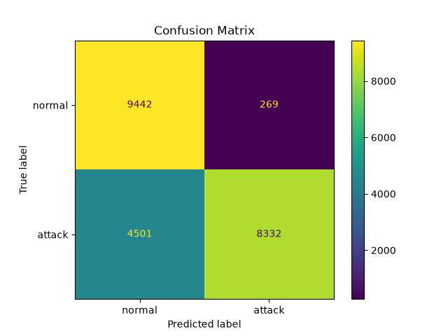
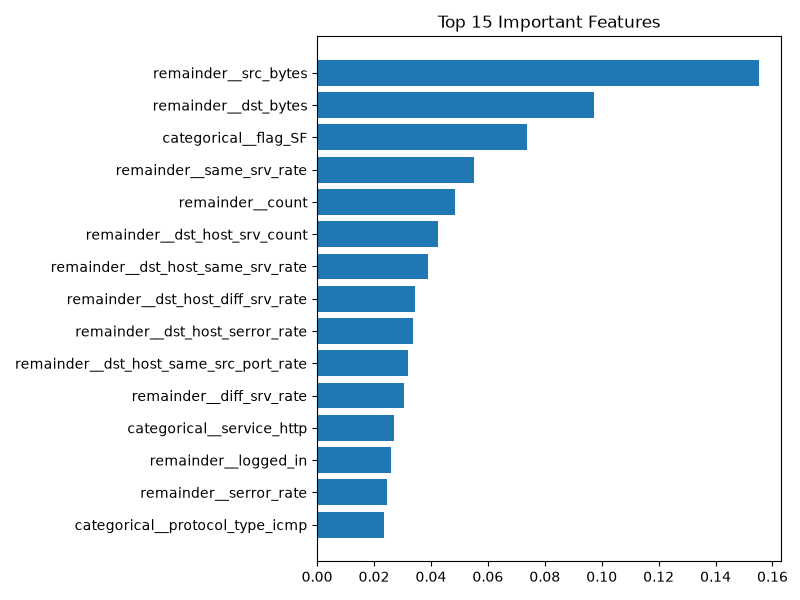

# Network Intrusion Detection System

A machine learning project that classifies network traffic as **normal** or **attack** using the NSL-KDD dataset and a Random Forest classifier.

## Overview

- **Dataset:** [NSL-KDD](https://www.unb.ca/cic/datasets/nsl.html) (`KDDTrain+` for training, `KDDTest+` for testing)
- **Task:** Binary classification (normal vs attack). All attack types (DoS, Probe, R2L, U2R) are grouped into one `attack` class.
- **Model:** Random Forest (100 trees, `class_weight='balanced'`)
- **Preprocessing:** One-hot encoding of `protocol_type`, `service` and `flag`, all other features passed through unchanged. Built as a scikit-learn `Pipeline`.
- **Tools:** Python, pandas, scikit-learn, matplotlib

## Results (on the unseen KDDTest+ set, 22,544 records)

| Metric | Score |
|---|---|
| Accuracy | 78.84% |
| Attack detection rate (recall) | 64.93% |
| Attack precision | 97% |
| Normal recall | 97% |
| Missed attack rate | 35.07% |

**Confusion matrix**

| | Predicted normal | Predicted attack |
|---|---|---|
| **Actual normal** | 9,442 | 269 |
| **Actual attack** | 4,501 | 8,332 |





## Analysis

- The model is **very reliable when it raises an alarm** (97% attack precision, only 269 false alarms out of 9,711 normal records).
- However, it **misses about 35% of attacks**. In intrusion detection, a missed attack is the costly error, so this is the main weakness.
- The accuracy is lower than on the training data because the NSL-KDD test set is intentionally harder: it contains attack types that never appear in the training set. This is closer to real-world conditions, where new attacks keep appearing, so the score reflects how the model handles unfamiliar threats.

## How to run

1. Download `KDDTrain+.txt` and `KDDTest+.txt` from the NSL-KDD dataset and place them in the project folder.
2. Install dependencies:
   ```
   pip install -r requirements.txt
   ```
3. Run:
   ```
   python intrusion_detection.py
   ```

The script prints the metrics, saves `confusion_matrix.png` and `feature_importance.png`, and saves the trained model as `intrusion_model.pkl`.

## Limitations and future work

- Improve attack recall by tuning the decision threshold or trying gradient boosting (XGBoost / LightGBM).
- Compare against other models such as Logistic Regression and Decision Tree.
- Extend to multi-class classification (DoS, Probe, R2L, U2R) to identify the attack type.
- Test on newer datasets (e.g. CIC-IDS2017) since NSL-KDD is dated.
